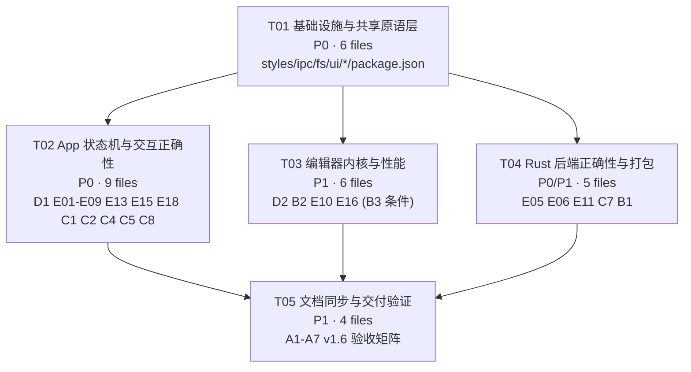

# MWTyper M3 打磨增量系统设计

- 版本：v1.0（增量设计，基于 SPEC v1.5 的实际代码状态）
- 撰写：高见远（Architect）
- 日期：2026-11-20
- 依据：`docs/review/architecture-review.md`（含 §6/§7 补充）、`docs/review/incremental-prd.md`（A/B/C/D 类）、`docs/review/qa-ux-review.md`（E01–E18 / U01–U20）、实际源码
- 性质：现有项目增量改造，**不新开工程、不引入任何未缓存依赖、不改 SPEC 的产品取舍（D3/D13 等）**

---

## Part A：系统设计

### 1. 实现方案（Implementation Approach）

#### 1.1 核心难点

1. **事实基线错位**：SPEC v1.5 把 8 项写成"押后 M3"，实际 7 项已落地。若按文档施工会重复造轮子。→ A 类文档同步必须与代码改造并行，且以代码为事实源。
2. **正确性欠账集中在 App 状态机**：QA 的 E01（自动保存定时器跨标签）、E02（stats 异步乱序）、E03（重命名/删除后 tabs.path 未同步）、E04（源码模式不刷新）、E09（CM 悬挂引用/定时器未清理）与架构 A01（stash 竞态）本质是同一个根因——**可变 ref + 异步回调 + 缺少请求/标签身份标识**。统一用"调用瞬间捕获身份快照 + 请求序号 + 卸载清理"三件套解决，而非逐个打补丁。
3. **性能热路径叠加**：`useEditor` 每事务全量 tick（A02/E14）+ 装饰全文重算（A04/A05）+ AI 提到的 LCS 重算（A03）。采用**分层治理**：先过滤无意义事务（最低成本），再做 decorations 增量，最后（后续轮次）下沉订阅。
4. **视觉/UX 地基为零**：全库无 `aria-*`、无 `:focus-visible`、无 `@media`、15 处原生弹窗。采用**共享原语优先**：先建 `Modal/Toast/useModal` 与设计 token，再批量替换，避免 15 处各自为战。
5. **NSIS 离线不可达**：工具链缺失是环境问题非代码问题。采用**两步验收 + 如实降级**，不把它变成阻塞 P0。

#### 1.2 技术选型与依据

| 决策 | 选择 | 依据 |
|---|---|---|
| 原生弹窗替换 | 自研 `ConfirmDialog`/`PromptDialog`/`ToastHost` + `useModal` | 项目已有 `.modal-backdrop/.modal/.palette` 样式（styles.css:260-341）；**禁止引入未缓存 UI 库**（纯离线 §2.1） |
| 测试基础设施 | 复用现有 `jsdom@31` + `tsx@4.23` + `typescript@5.9` | QA 建议的 Vitest/RTL/axe-core **均未缓存**，离线不可得；用 jsdom 手动挂载 App + DOM 查询即可覆盖状态机回归 |
| 设置扩展 | `#[serde(default = "...")]` 前向兼容（sidebar_width） | fs.rs:163-200 已是该模式，无需数据迁移 |
| 装饰增量 | `tr.changes.iterChangedRanges` + `old.map(tr.mapping, tr.doc)` | ProseMirror 原生 API，零依赖；已有 jsdom 事务测试台可验等价性 |
| 渲染治理 | `useEditor` 增 `rerenderOn?` 谓词，默认 `docChanged \|\| selectionSet`，find meta 放行 | 最小侵入；阶段二（订阅下沉）风险收益不匹配，本轮不做 |
| 构建验证 | `pnpm tauri build --no-bundle` → 完整 `pnpm tauri build` | 分离"编译链"与"NSIS 工具链"两个失败面 |

#### 1.3 架构模式

- 保持现有**单一边界 IPC 层**（`ipc.ts` 的 Tauri invoke / localStorage mock 分流）——这是项目最成功的结构决策，本设计不触碰其契约形状，只扩展 Settings 字段。
- 保持**编辑器内核与 UI 外壳分离**：`useEditor` 薄封装继续只管事务与渲染时机，业务状态留在 App。
- 新增**共享 UI 原语层** `src/ui/`，把散落在 15 处的弹窗逻辑收敛为可复用组件。

---

### 2. 文件清单（File List）

> 路径相对于项目根。标记：`[新]` 新建、`[改]` 修改。按任务分组，每个文件只归属一个任务（避免并行冲突）。

**T01 基础设施与共享原语层**
- `package.json` [改] — 新增 `test` 聚合脚本（typecheck + 4 个 spike + cargo test 提示），零新依赖
- `src/styles.css` [改] — 设计 token（`--accent-strong`/`--warn-fg`/`--overlay-bg`/`--shadow-modal`/`--radius-modal`/`--diff-add`/`--diff-del`）、全局 `:focus-visible`、`prefers-reduced-motion`、对比度修正、响应式 `@media`、标题栏/侧栏布局、浮层统一、空态、滚动条与字体继承（覆盖 U01/U03–U20 的 CSS 部分）
- `src/ipc.ts` [改] — `Settings` 增 `sidebar_width`，mock `defaultSettings` 补默认值；mock 全词匹配对齐 Unicode（E12）
- `src-tauri/src/fs.rs` [改] — `Settings` 增 `#[serde(default = "d_sidebar_width")]` + Default；`build_dir` 用 `symlink_metadata` 跳符号链接并限深 32（E17）
- `src/ui/Modal.tsx` [新] — `useModal`（Esc/焦点陷阱/焦点归还）、`ConfirmDialog`、`PromptDialog`
- `src/ui/Toast.tsx` [新] — `ToastHost` + `success/error/info`，3–5s 自动消失

**T02 App 状态机与交互正确性**
- `src/App.tsx` [改] — D1 stash 快照、E01 定时器清理+关窗 flush、E02 statsSeqRef、E03 rename/delete 同步 tabs.path、E07 输入框快捷键守卫、E09 setTimeout ref 清理、E13 设置防抖、E15 会话分钟 tick、E18 三定时器 cleanup；15 处原生弹窗替换为 Modal/Toast；C2 标题栏分组/图标化/省略；C4 侧栏拖拽 + 缩放行宽联动；C5 状态反馈；C8 空状态
- `src/editor/SourceMode.tsx` [改] — `useEffect([doc])` 同步外部重载/快照恢复；`onReady(null)` 卸载清理（E04/E09）
- `src/sidebar/SearchPanel.tsx` [改] — 请求序号防乱序（E08）；FlagToggle 复用；aria-pressed
- `src/editor/shortcuts.ts` [改] — Ctrl+K 从 `window.prompt` 改为注入回调，由 App 提供 PromptDialog
- `src/sidebar/HistoryPanel.tsx` [改] — Esc 关闭 + role=dialog（复用 useModal）；失败走 Toast
- `src/settings/SettingsPanel.tsx` [改] — Esc 关闭、数字输入本地 string state + onBlur 提交（E15）、侧栏宽度项、"打开主题目录"按钮（C7，需 T04 命令）
- `src/commands/Palette.tsx` [改] — 焦点陷阱 + aria-modal（复用 useModal）
- `src/editor/FindReplaceBar.tsx` [改] — FlagToggle 复用、aria-label
- `src/sidebar/FileTree.tsx` [改] — treeitem/键盘可达、右键菜单视口钳制、空态按钮

**T03 编辑器内核与性能**
- `src/editor/useEditor.ts` [改] — `rerenderOn?` 谓词（D2 阶段一）
- `src/editor/code-block.ts` [改] — 高亮装饰增量（B2/A04）
- `src/editor/find-replace.ts` [改] — 导出 `findKey`；matches 增量（B2/A05）；跨节点命中（B3，条件性，见 §5 Q2）
- `src/editor/image-assets.ts` [改] — 插入失败 try/catch + Toast 回调；多图递增位置（E10）
- `src/sidebar/Outline.tsx` [改] — 源码模式统一走 markdown.parse 解析，修索引错配（E16）
- `spikes/m1-editor.ts` [改] — 追加装饰等价性 + 渲染计数回归

**T04 Rust 后端正确性与打包**
- `src-tauri/src/lib.rs` [改] — `escape_html` 属性上下文转义 `"`/`'`（E05）；raw HTML 透传策略加注
- `src-tauri/src/export.rs` [改] — 图片 base64 内嵌路径 `canonicalize` 校验必须在 base_dir 内（E11）
- `src-tauri/src/search.rs` [改] — `truncated` 用原子 stopped 标记（E06）；并行 vs 单线程一致性测试；基准刷新
- `src-tauri/src/themes.rs` [改] — 新增 `reveal_themes_dir` 命令（C7，rfd/explorer 抽象）
- `src-tauri/tauri.conf.json` [改] — B1 两步构建验证（如需调整打包配置）

**T05 文档同步与交付验证**
- `SPEC.md` [改] — A1/A2/A3/A6 标 7 项已落地；A4 回填实测基准与 dist 体积；A7 新增 v1.6 变更记录；B1 两步构建日志
- `spikes/M2-CONCLUSIONS.md` [改] — A5 纠正 focus.ts 归类；补 NSIS 离线 blocker、分包已落地、并行化进度
- `spikes/M1-CONCLUSIONS.md` [改] — 同步分包/decorations 真实状态
- `docs/review/delivery-verification.md` [新] — 全量验收矩阵与实测结果

---

### 3. 数据结构与接口（Data Structures and Interfaces）

完整类图见 `docs/class-diagram.mermaid`。核心新增/变更接口摘要：

```ts
// src/editor/useEditor.ts —— D2 阶段一新增
export interface EditorHostOptions extends Partial<EditorOptions> {
  /** 默认仅 docChanged/selectionSet 触发宿主重渲染；find 插件 meta 由 App 放行 */
  rerenderOn?: (tr: import("@tiptap/pm/state").Transaction) => boolean;
}

// src/ipc.ts —— Q6 新增（其他字段不变）
export interface Settings {
  // ...既有 11 字段不变
  sidebar_width: number; // 180–420，serde default 240
}

// src/ui/Modal.tsx —— 新增共享原语
export function useModal(close: () => void, initialFocus?: RefObject<HTMLElement>): {
  onKeyDown: (e: React.KeyboardEvent) => void; // Esc + Tab 焦点陷阱
  restoreFocus: () => void;                    // 关闭后归还焦点
};
export function ConfirmDialog(props: {
  open: boolean; title: string; message: string;
  danger?: boolean; onConfirm: () => void; onCancel: () => void;
}): JSX.Element;
export function PromptDialog(props: {
  open: boolean; title: string; defaultValue?: string;
  onSubmit: (value: string) => void; onCancel: () => void;
}): JSX.Element;

// src/ui/Toast.tsx
export function ToastHost(props: { toasts: Toast[]; onDismiss: (id: number) => void }): JSX.Element;
export type Toast = { id: number; kind: "success" | "error" | "info"; message: string };

// src-tauri/src/themes.rs —— C7 新增命令
#[tauri::command]
pub fn reveal_themes_dir() -> Result<(), String>;
```

关键的**身份快照**契约（D1/E01/E02 共用，写在 App 内的局部常量，不改签名）：

```
stashActive(): 在调用瞬间捕获 leavingId / leavingText / leavingPath / leavingDirty → setTabs 更新器只读这四个局部常量
activateTab/loadBuffer: 入口先 clearTimeout(autoTimer)；statsSeqRef++；回调校验序号
```

---

### 4. 程序调用流程（Program Call Flow）

完整时序图见 `docs/sequence-diagram.mermaid`，覆盖：初始化 → 打开文件夹/文件 → WYSIWYG 编辑与增量装饰 → **标签切换（D1/E01 关键路径）** → 查找替换 → 源码模式与命中跳转 → 保存（Toast 反馈）→ 设置持久化 → NSIS 打包验证。

其中三处关键修复的流程语义：

1. **标签切换**：`clearTimeout(autoTimer)` → `stashActive()` 快照 → `activeIdRef=tabB.id` → `loadBuffer(tabB)`（`statsSeqRef++`）→ `setContent` → `stats` 回调校验序号。
2. **装饰增量**：`transaction(docChanged)` → 谓词判断 → 仅对 `tr.changes.iterChangedRanges` 覆盖的 block 重算 → 其余 `old.map(tr.mapping, tr.doc)` → 谓词决定是否 setTick。
3. **保存反馈**：`saveFile` 原子写 → `Toast "已保存"` → 快照 → 刷新树（不再 alert）。

---

### 5. 不明确之处与假设（Anything UNCLEAR）

| # | 事项 | 本设计假设 | 需谁拍板 |
|---|---|---|---|
| Q1 | NSIS 工具链离线不可得 | 接受"编译链已验证 + 如实标注离线不可打包"作为交付，不判 P0 | team-lead（PRD Q1） |
| Q2 | WYSIWYG 跨节点查找（B3） | **本轮默认不做**，T03 中仅保留代码位置，不改变行为；若要做则在 T03 内追加 | team-lead（PRD Q2） |
| Q3 | undo 不跨标签（D13） | 继续作为已知取舍，不改架构 | team-lead（PRD Q3） |
| Q4/Q8 | 基准与 dist 体积实测回填 | 本轮实跑 `bench_10k_files` 与 `vite build`，数据写入 T05 | team-lead（PRD Q4/Q8） |
| Q5 | C 类范围 | 按本设计 T01（CSS 地基）+ T02（App 接线）全量覆盖 C1–C8；若工期不足，优先 C1/C2/C3，C7/C8 可降级 | team-lead（PRD Q5） |
| Q6 | sidebar_width 持久化 | 采纳（架构绿灯），已在 T01/T02 排入 | team-lead（PRD Q6） |
| Q7 | D1/D2 归属与范围 | D1 必做且 QA 主导复现；D2 只做阶段一（谓词过滤），阶段二下沉订阅留后续 | team-lead（PRD Q7，与本人建议一致） |
| A | 测试依赖 | **不引入** Vitest/RTL/axe-core（未缓存）；用 jsdom + tsx 手写挂载测试 | 已由离线硬边界决定 |
| B | QA 的 rustc `STATUS_ACCESS_VIOLATION` | 视为环境故障（QA 已验证非源码错误）；T04 验证时若复现，记录并跳过 cargo 部分，不阻断前端交付 | 工程师现场判断 |
| C | E05 raw HTML 透传 | v1.3 为"防静默丢内容"有意选择；本设计只补属性转义与安全提示，**不改变透传策略**，避免回归 | 已定（架构判断） |

---

## Part B：任务分解

### 6. 所需依赖（Required Packages）

**不新增任何第三方依赖**（纯离线硬边界 §2.1）。复用：

```
- react@18.3.1 / react-dom@18.3.1：UI 框架（现状）
- @tiptap/*@3.22.1 + @tiptap/pm：编辑器内核（现状）
- @codemirror/*@6 + codemirror@6.0.2：源码模式（现状）
- @tauri-apps/api@2.11.1 / @tauri-apps/cli@2.11.4：IPC 与打包（现状）
- typescript@5.9.3 / vite@6.4.3 / @vitejs/plugin-react@4.7.0：构建（现状）
- jsdom@31.0.0 / tsx@4.23.15：测试（现状，替代未缓存的 RTL/Vitest）
- highlight.js@11.11.1（lib/core + 24 语言按需）/ katex@0.16.25 / dompurify@3.4.18 / prosemirror-tables@1.8.1：功能库（现状）
- Rust: tauri@2 / tauri-build@2 / serde / pulldown-cmark@0.13 / syntect@5 / notify@6 / walkdir@2 / regex@1 / chrono@0.4 / rfd@0.15 / base64@0.22（现状）
```

**明确排除**：Vitest、@testing-library/react、axe-core、@vitejs/plugin-legacy、任何新增 tiptap 扩展（全部未缓存或会破坏 pin 约束）。

---

### 7. 任务列表（按依赖排序，共 5 个）

#### T01 — 基础设施与共享原语层
- **优先级**：P0
- **依赖**：无
- **源文件**：`package.json`、`src/styles.css`、`src/ipc.ts`、`src-tauri/src/fs.rs`、`src/ui/Modal.tsx`(新)、`src/ui/Toast.tsx`(新)
- **内容**：建立设计 token 与 a11y CSS 地基（U01/U03–U20）；Settings 增 `sidebar_width` 前后端字段（Q6/E12）；建共享 Modal/Toast/useModal 原语；`package.json` 加 `test` 聚合脚本；fs.rs 符号链接防护（E17）
- **验收**：`tsc --noEmit` 绿；`vite build` 绿；旧 settings.json（无 sidebar_width）能反序列化并取默认 240

#### T02 — App 状态机与交互正确性
- **优先级**：P0
- **依赖**：T01
- **源文件**：`src/App.tsx`、`src/editor/SourceMode.tsx`、`src/sidebar/SearchPanel.tsx`、`src/editor/shortcuts.ts`、`src/sidebar/HistoryPanel.tsx`、`src/settings/SettingsPanel.tsx`、`src/commands/Palette.tsx`、`src/editor/FindReplaceBar.tsx`、`src/sidebar/FileTree.tsx`
- **内容**：修复 D1/E01/E02/E03/E04/E07/E08/E09/E13/E15/E18（数据正确性与生命周期）；15 处原生弹窗改共享原语（C1）；标题栏分组与省略（C2）；侧栏拖拽与缩放行宽（C4/Q6）；状态反馈（C5）；空态（C8）；a11y 属性接线（U02/U20）
- **验收**：QA 主导的 D1 复现用例（autosave=0，输入→切 B→切回 A 文本不丢）通过；E01/E03 各 1 条回归通过；`window.alert/confirm/prompt` 在 `src/` 零残留；`m1ipc 15/15`、`m1editor 13/13` 无回归

#### T03 — 编辑器内核与性能
- **优先级**：P1
- **依赖**：T01
- **源文件**：`src/editor/useEditor.ts`、`src/editor/code-block.ts`、`src/editor/find-replace.ts`、`src/editor/image-assets.ts`、`src/sidebar/Outline.tsx`、`spikes/m1-editor.ts`
- **内容**：D2 阶段一（rerenderOn 谓词，find meta 放行）；B2 装饰增量（hljs/find 两处，old.map + iterChangedRanges）；E10 图片失败反馈；E16 大纲解析统一；B3 跨节点查找（条件性，Q2）
- **验收**：装饰增量结果与原全文重算在相同文档上逐项一致（等价性单测）；渲染计数证明纯装饰/meta 事务不触发 App 顶层渲染；打字仍触发；roundtrip 不动点 PASS

#### T04 — Rust 后端正确性与打包
- **优先级**：P0（正确性）/ P1（打包）
- **依赖**：T01
- **源文件**：`src-tauri/src/lib.rs`、`src-tauri/src/export.rs`、`src-tauri/src/search.rs`、`src-tauri/src/themes.rs`、`src-tauri/tauri.conf.json`
- **内容**：E05 属性转义（不改名实透传策略）；E11 内嵌图片路径校验；E06 truncated 原子标记 + 一致性测试 + 基准刷新（Q4/Q8）；C7 `reveal_themes_dir`；B1 两步打包验证
- **验收**：`cargo test --lib` 全绿（若 rustc 环境故障复现则记录并标注）；单文件多命中触顶 truncated=true；导出属性注入测试通过；两步构建日志写入 T05

#### T05 — 文档同步与交付验证
- **优先级**：P1
- **依赖**：T02、T03、T04
- **源文件**：`SPEC.md`、`spikes/M2-CONCLUSIONS.md`、`spikes/M1-CONCLUSIONS.md`、`docs/review/delivery-verification.md`(新)
- **内容**：A1–A7 文档同步（7 项已落地、快捷键表、基准与体积实测回填、v1.6 变更记录）；汇总全量验收矩阵
- **验收**：SPEC 与代码状态零矛盾；验收矩阵每条附证据（命令/输出/截图说明）

---

### 8. 共享知识（Shared Knowledge）

工程师落地时必须遵守的跨任务约定：

1. **事实源**：SPEC 与 spike 结论若与代码冲突，以代码为准；文档修正统一在 T05 完成，改造期不要边写边改文档造成口径分裂。
2. **禁止新依赖**：任何 `pnpm add` / `cargo add` 都违反离线硬边界；测试用 jsdom + tsx 手写。
3. **身份快照纪律**：凡在 `setState` 更新器内读取 `useRef` 的地方，一律先在调用瞬间捕获为局部常量（D1）；这同时适用于定时器与异步回调。
4. **请求序号**：所有可能乱序的异步回调（stats/search）用自增序号 ref 校验后才写 state（E02/E08）。
5. **生命周期清理**：所有 `setTimeout`/`setInterval`/事件监听必须在 effect cleanup 中清理（E01/E09/E18）；`onReady` 必须支持 `null` 以释放 CM 引用。
6. **弹窗统一**：`window.alert/confirm/prompt` 在 `src/` 中零残留；确认类用 ConfirmDialog、输入类用 PromptDialog、反馈类用 Toast；全部经 useModal 支持 Esc/焦点陷阱/aria。
7. **装饰器约定**：`focus.ts` 是 O(1) 单 node decoration（D13 已知取舍），**不在优化范围**；只改 `code-block.ts` 与 `find-replace.ts`。
8. **不碰产品取舍**：undo 不跨标签（D13）、纯 .md 无专有格式（D3）、raw HTML 透传（v1.3 选择）均保留；跨节点查找（B3）按 Q2 决定。
9. **每批验证**：`tsc --noEmit` + `vite build` + `pnpm test`（新聚合脚本） + `cargo test --lib`（环境允许时）；任一红灯不得进入下一任务。
10. **NSIS 口径**：离线工具链不可得是环境限制，记录为"配置与编译链就绪、离线不可打包"，**不得判为配置错误或 P0**。
11. **术语**：Session 基线 = 打开/切换标签时字数（D13）；会话分钟需 60s tick（E15）；`statsSeqRef` 与 `statsTimer` 是不同概念。

---

### 9. 任务依赖图（Task Dependency Graph）



**并行提示**：T02 / T03 / T04 在 T01 完成后三者互不共享文件，可并行；T05 必须等三者全部完成以拿到实测数据。若人力有限，串行顺序建议 T01 → T02（正确性优先）→ T04 → T03 → T05。

---

## 附：需求追溯矩阵（Traceability）

| 来源编号 | 归属任务 | 来源编号 | 归属任务 |
|---|---|---|---|
| A1/A2/A3/A6/A7 | T05 | E01/E02/E03/E07/E09/E13/E15/E18 | T02 |
| A4/A5 | T04（实测）+ T05（回填） | E04 | T02 |
| B1 | T04 + T05 | E05/E11 | T04 |
| B2（架构 A04/A05） | T03 | E06 | T04 |
| B3 | T03（条件） | E08 | T02 |
| C1/C2/C4/C5/C8 | T02 + T01（CSS） | E10/E16 | T03 |
| C3/U01/U02/U20 | T01（CSS）+ T02（属性/接线） | E12 | T01 |
| C6/C7 | T02（UI）+ T01/T04（CSS/命令） | E14（架构 A02） | T03 |
| D1（架构 A01） | T02 | E17 | T01 |
| D2（架构 A02） | T03 | U03–U19 | T01 |
